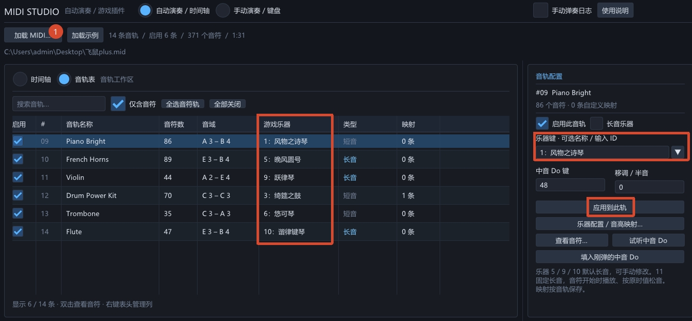
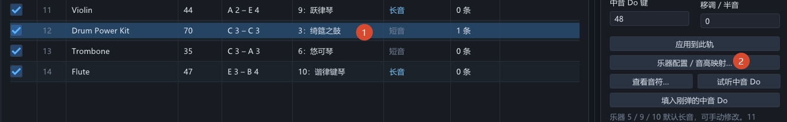
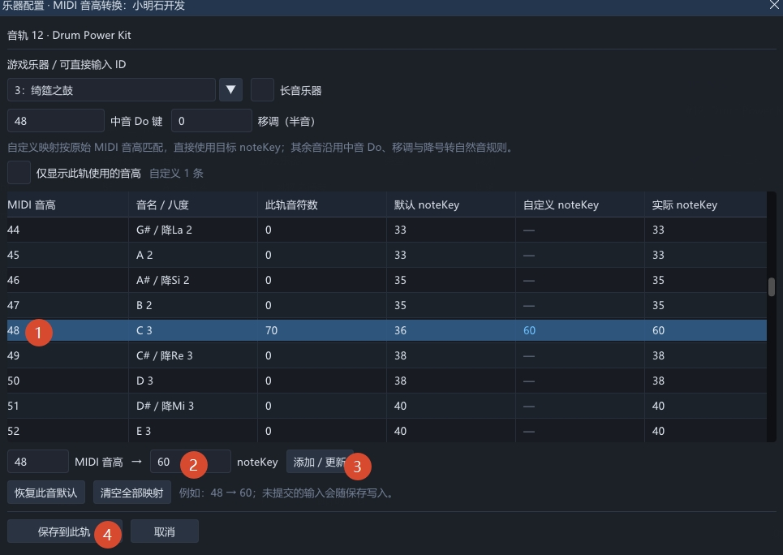

# MIDI 自动演奏插件

独立的 Windows x64 注入式 DLL，使用 Dear ImGui + DirectX 11 的独立窗口。提供自动演奏、手动演奏和创作三种模式：可导入 MIDI 配置音轨，也可在共用的钢琴卷帘上创作多轨乐曲并导出 MIDI。界面采用深色主题，自动演奏页以多轨时间轴或音轨表管理音轨，右侧配置乐器，底部控制播放并展开手动日志。默认筛选含音符的音轨，取消“仅含音符”可显示全部音轨。为每条音轨设置游戏乐器键、长短音、中音 Do 的 noteKey 和移调，再按 MIDI 时间进行演奏。

## 文件

- `dist/MidiPlayerPlugin.dll`：游戏插件，通过第三方启动器加载后启动原神（`YuanShen.exe`）。
- `dist/MidiPlayerPreview.exe`：可直接打开的界面与调度预览，不连接游戏、不发声。
- `examples/飞鼠plus.mid`：示例 MIDI。共 14 条音轨，6 条含音符，371 个音符，约 91.042 秒。
- `dist/MidiPlayer.ini`：自动生成的配置文件。按 MIDI 文件内容和音轨编号保存配置，重命名同一 MIDI 后仍可恢复。

保留 `dist` 和 `examples` 的目录关系，面板的“加载示例”按钮才能找到示例。也可以用“加载 MIDI…”选择任意 `.mid` 或 `.midi` 文件。DLL 和预览程序使用静态 C++ 运行库，正常使用不需要 Python、Frida 或 IDA。

## 在游戏中使用

1. 通过任意支持 DLL 插件加载的第三方启动器加载 `dist/MidiPlayerPlugin.dll`，然后启动原神。游戏启动后，插件面板默认隐藏；按 `Ctrl+-` 呼出，等待“入口”状态显示 Ready。插件按特征和调用关系定位函数，选择当前版或旧版的参数形式。
2. 进入游戏内的短音乐器演奏界面（如风物之诗琴），手动弹一个音，完成演奏校准。
3. 加载 MIDI，勾选参与演奏的音轨。双击一条音轨，或选中后点击右侧“查看音符…”按钮，可查看其中每个音的时间和音高。空轨、速度轨和控制轨也会显示，默认关闭；速度和控制事件仍参与 MIDI 解析。
4. 选中音轨，右侧的“乐器键”为可编辑下拉框，可选择带名称的预设乐器，或直接输入自定义数字 ID；选择“x：自定义数字”也可清空后输入。乐器 5（晚风圆号）、9（跃律琴）、10（谐律键琴）默认勾选长音，其余普通乐器（包括 8：余音）默认短音，可手动修改。11（沃雅妮莎）固定为“长音”。点击“乐器配置 / 音高映射…”可编辑更多设置，最后点击“保存到此轨”。右侧也可直接修改基本配置，点击“应用到此轨”。切换音轨、试听或开始播放也会提交主界面当前轨的修改。
5. **（可选）** 在游戏中手动弹你定义的中音 Do，再点“填入刚弹的中音Do”，把最近的乐器键和 noteKey 填进所选音轨。插件不能判断手动弹的音是不是 Do，需要自行选择正确的音。
6. **（可选）** 用“试听此轨中音Do”确认设置。

配置完成后，点击“开始 / 继续”，在倒计时内切回游戏演奏界面。倒计时默认 3 秒，可设为 0–30 秒。

“乐器键”是游戏播放函数接收的内部配置键，不是 MIDI Program 编号，也不是背包物品 ID。列表中的 Program 按 1–128 显示，供识别 MIDI 乐器使用，不会自动转换成游戏乐器。

在两个配置界面选择乐器或更换数字 ID 时应用默认长短音；已保存的手动设置在重新加载或切换音轨时恢复。

长音按 MIDI 的 note-off 和延音踏板时间停止；短音在 note-on 时触发。当前版长音调用中额外的标志参数优先使用手动演奏该乐器时捕获的值，没有捕获时使用 0；配置长音乐器后，建议先手动弹一次该乐器完成验证。

11（沃雅妮莎）在每个 note-on 立即播放 ID 11 的长音，按原定 MIDI note-off 和延音踏板时间停止；所有有效时长的音符均使用长音入口。调整播放速度后，完整长音时长随速度缩放。暂停、跳转和停止会清理已启动的长音，恢复时重新启动当前应持续的长音。试听从开始立即发长音，第 600 毫秒松音。旧配置即使保存为短音，选择 11 后仍执行长音规则。

音高在生成演奏计划时先按下文规则将降号音转成自然音。若游戏仍正常返回空长音句柄，插件会略过这一音符并继续后续演奏，不为它发送停止调用。状态栏显示略过数量，以及最近一次的音轨、曲内时间、乐器 ID、实际 noteKey 和原始 MIDI 音高，便于识别乐器不支持的音域。原生异常、线程错误和长音停止失败仍会中止播放。

勾选窗口右上方的“手动弹奏日志”，可在底部展开滚动日志区域。每条记录以弹奏发生时的本地时间 `[HH:mm:ss.fff]` 开头，精确到毫秒，随后显示长短音、乐器 ID 和 noteKey：

```text
[23:45:12.083] [短音] 乐器id=1 noteKey=36
[23:45:13.216] [长音] 乐器id=11 noteKey=48
```

日志记录游戏内原始手动输入，以及下述手动演奏页实际进入短音或长音播放函数的调用；不显示自动演奏和试听触发的音符。插件手动演奏日志不会覆盖原生校准值。最多保留最近 200 条，取消勾选后停止记录并清空；重新勾选开始新的记录。预览程序可查看日志区域的界面，实际记录需在游戏中使用 DLL。

## 飞鼠plus 配置示例

导入 [飞鼠plus.mid](examples/飞鼠plus.mid) 后，可按下面三步配置音轨和鼓声映射。

1. 切换到“音轨表”，启用图中的 6 条音轨，分别选择对应的游戏乐器和长短音类型，再点击“应用到此轨”。



2. 选中第 12 轨 `Drum Power Kit`，使用 `3：绮筵之鼓` 和短音，点击“乐器配置 / 音高映射…”。



3. 选择 MIDI 音高 `48`，将目标 `noteKey` 设为 `60`，点击“添加 / 更新”，再点击“保存到此轨”。保存后，该轨的 70 个音符都使用 `48 → 60` 的自定义映射。



## 手动演奏

主界面顶部标题栏选择“自动演奏 / 时间轴”或“手动演奏 / 键盘”。手动演奏页为独立的三排、每排七个音的演奏界面，无需加载 MIDI。左侧选择预设乐器或输入 ID，调整长短音、中音 Do 和移调；右侧显示键盘、唱名和实际 noteKey。设置保存在 `MidiPlayer.ini` 的 `[performance]` 节，不改变各 MIDI 音轨配置。切入此页会停止自动演奏。

| 音区 | do | re | mi | fa | so | la | ti |
| --- | --- | --- | --- | --- | --- | --- | --- |
| 高音 | Q | W | E | R | T | Y | U |
| 中音 | A | S | D | F | G | H | J |
| 低音 | Z | X | C | V | B | N | M |

中排 A 为中音 Do，上下排分别高、低一个八度。默认中音 Do 为 noteKey 48，因此 Q/A/Z 分别为 60/48/36；每排使用自然音间隔。也可在游戏内弹中音 Do 后点击“填入刚弹的中音 Do”完成校准。

支持多个键同时按下演奏和弦，以及鼠标按住音块。短音每次按下触发一次；长音按住持续、松开停止。11 号固定使用长音，按下立即播放，松键停止。

键盘只在演奏面板位于前台时生效；编辑文本或数字、打开下拉菜单时暂停接收音符。切换页面、隐藏、失焦或修改演奏配置会全部松音。可点击“全部松音 / Esc”、按 Esc 或使用 Ctrl+Alt+S 清理当前手动音符。声音仍由捕获到的游戏线程调用，需保留游戏乐器界面并先完成对应短音/长音校准。预览程序只显示按键反馈，不合成音频。

## 创作模式

主界面顶部选择“创作模式 / 钢琴卷帘”。所有音轨共用一张时间轴：横向为拍，纵向为音高；上方刻度从 0 开始，每半拍一格，显示为 0、0.5、1、1.5…，缩小时自动减少数字显示以避免重叠；不同音轨的音符使用不同颜色，当前轨更醒目。音高与手动演奏完全一致，只提供三排 21 个自然音（MIDI 48–83 中的 do、re、mi、fa、so、la、ti），左侧显示对应的 Q–U、A–J、Z–M 按键和唱名。低音使用“↓”、高音使用“↑”，中音直接显示唱名，例如“Z ↓do、A do、Q ↑do”。

可点击“导入 MIDI…”载入已有 `.mid` / `.midi` 文件继续编辑。导入保留音轨名称、音符起止位置、力度及原有速度变化；本插件导出的 MIDI 还会恢复游戏乐器配置。半音向上提高一个半音转为自然音，超出三排音域的音符跳过；转换后同轨、同音高的重叠音符合并，界面显示导入、转换、跳过和合并数量。导入会替换当前草稿，可通过撤销恢复。速度和控制空轨不作为创作音轨显示，速度变化仍保留。

点击“保存工程…”可将完整创作保存为 `.mpc` 文件，方便备份或继续编辑；“导入工程…”会恢复所有音轨及音符、轨名、乐器、长短音、中音 Do、轨色和显示开关，总拍数、BPM / 每拍时长及速度变化，以及网格、新音时长和力度、缩放、视窗起点、黄色指针位置、当前音轨和音符选择、左侧面板宽度与设置页、音轨列表滚动位置及“接收游戏弹奏”开关。拍长、颜色和非整拍音符保留原有精度。导入后保持停止状态，可直接继续编辑或从指针位置播放；也可撤销 / 重做整次工程导入。导入前会完整校验文件，读取失败时保留当前工程。保存和导入工程需先停止播放、结束即时创作。

1. 点击“+ 添加音轨”，在左侧“音轨设置”中命名并选择游戏乐器及长短音。可添加最多 128 条音轨；“更多设置”中可修改轨色、中音 Do 键或删除音轨。
2. 选择要编辑的音轨，在时间轴空白处点击添加音符，添加成功后会使用此轨乐器试听一次。网格支持 1 拍到 1/16 拍；“新音时长 / 拍”默认 1 拍，可直接输入。新添加的音符沿用上一次添加、选中或调整过的音符长度，包括导入音符的非整拍时长；到达时间轴末尾时会缩短到剩余长度。
3. 拖动音符可调整开始位置和音高，单选时拖动右边缘可调整时长。按住 Ctrl 点选可添加或取消多选；按住 Ctrl 从时间轴音符区的空白处用鼠标左键拖动，可像 Windows 一样显示矩形框，将与框相交的可见音符加入选择，保留原有选择并支持跨音轨框选。框选途中缩小或改变拖动方向会实时更新选择，松开鼠标后保留结果；Esc 或窗口失去焦点可取消本次框选，隐藏音轨不参与框选。拖动任一已选音符会整体移动时间和音高，保留音符之间的间隔、时长和所属音轨。点击音符会切到左侧“音符设置”，单选时可精确填写开始拍数、时长和力度。右键已选音符、按 Del（Delete）或点击删除按钮可删除所选音符；鼠标无需停留在卷帘内，正在输入文本或弹窗中时不触发删除。支持“撤销 / 重做”、Ctrl+Z、Ctrl+Y 和 Ctrl+Shift+Z。同一轨的同音高音符不能重叠，整组移动发生冲突时保持原位，不同音轨可叠加和弦。
4. 音轨名前的开关控制显示；“只显示此轨”可隐藏其他轨，“显示全部”可恢复。隐藏只影响编辑时的显示，所有音轨仍参与播放和 MIDI 导出。
5. “每拍 / 毫秒”和“BPM”均可直接输入，双向自动换算：每拍毫秒 = 60000 / BPM，例如 120 BPM 对应 500 毫秒、150 BPM 对应 400 毫秒。默认 500 毫秒，即 120 BPM；拍长范围为 10–16000 毫秒，对应 3.75–6000 BPM。导入 MIDI 的速度变化仍保留；“统一拍长”可清除速度变化及旧草稿中的单拍覆盖，让整曲使用默认拍长。
6. 用“总拍数”设置时间轴长度（1–4096 拍）。黄色指针默认在曲首显示，点击或拖动上方刻度选择起播位置，松开后跳转；播放、暂停时也可调节进度。“播放创作”点击后立即从指针位置演奏全部音轨，无倒计时；暂停保留位置，停止回到曲首。缩放支持 1–100 倍，可查看不足一拍的范围，工程保存和导入会恢复缩放；视窗起点滑块控制显示范围；底部横向滚动条可拖动滑块或点击轨道来平移视图，显示全曲时滑块占满。按住空格进入拖动模式，再用鼠标左键拖动时间轴可横向平移，不会添加、选中或移动音符。鼠标置于时间轴上，按住 Ctrl 滚动滚轮可围绕鼠标位置缩放，Shift+滚轮可平移，“全曲”恢复全部范围。这些视图操作在播放时也可使用。点击左侧音高键会使用所选乐器响一次；新增音符和音高键的长音试听均会在约 250 毫秒后自动松音，键盘和弦可同时试听多个音。
7. 点击“导出 MIDI…”选择保存路径。导出标准多轨 MIDI，保留音高、起止位置、力度、拍长变化、音轨名称及游戏乐器设置。在自动演奏页重新导入后，会恢复导出的乐器、长短音和中音 Do 设置；该文件已有的本地配置优先。

普通创作时也可以直接用 Q–U、A–J、Z–M 键盘添加音符，无需开启即时创作。先点击或拖动上方刻度定位黄色指针，再按音符键，音符会写入当前音轨的指针位置，沿用当前新音时长并试听；同时按多个键可添加和弦。按住按键不会重复添加，指针保持原位；继续录入其他位置时先移动指针。键盘需在插件窗口位于前台时使用，输入文本或数字、打开菜单、按住 Ctrl / Alt / Win、拖动音符或播放期间不接收普通录入。

选中单个或多个音符后，Ctrl+C 复制，Ctrl+X 剪切，Ctrl+V 粘贴。粘贴时最早的音符对齐黄色指针，保留音符之间的时间间隔、音高、时长和力度，并自动选中新音符，可反复粘贴。单轨音符粘贴到当前选中音轨；跨轨多选以当前音轨为起点，保留原有相对音轨位置，目标音轨不足时自动新增并沿用对应来源轨的乐器和颜色。剪切和每次粘贴均可一次撤销；遇到同轨同音高重叠、超出时间轴或音轨上限时整组不粘贴。正在输入文本或数字、打开菜单、播放、即时创作或拖动时不触发音符剪贴快捷键。

点击“即时创作”，黄色指针会从当前位置按拍长和速度变化向后推进。使用插件的 Q–U、A–J、Z–M 键盘或按住左侧音高键，音符会立即写入所选音轨的对应位置；按住期间持续延长时值，松开后结束，可同时按多个键录入和弦。

“接收游戏弹奏”默认开启：开始即时创作后切回游戏，手动弹奏的音也会写入当前选中音轨，无需开启手动日志。插件按原始游戏输入的时间戳定位，窗口在后台、最小化或通过 Ctrl+- 隐藏时仍持续录入。短音使用当前新音时长，长音从游戏播放到松音的实际时长录入；按所选音轨的中音 Do 键映射到三排自然音，超出音域或无法对应的音跳过。游戏音已由游戏发声，录入不会再次试听，也不会捕获本插件的自动演奏、试听或键盘发声。取消“接收游戏弹奏”后只录入插件键盘，失去焦点会结束录入。

录入保留实际时间，不自动对齐网格；起点与同轨同音高的已有音符重叠时跳过，延长时值时最多延伸到下一同音高音符之前。可切换所选音轨继续录入，视窗自动跟随指针；拖动顶部刻度可重新定位，已录入的长音在此结束，新位置只记录重新按下的音。点击“结束即时创作”保留当前指针位置；到达总拍数末尾、切换模式或关闭窗口也会结束录入。插件自己的长音会松开，游戏内手动音仍由游戏控制。整次录入可一次撤销。

编辑会自动保存到 `dist/MidiPlayer.ini.composition`，切换模式或下次打开插件时保留草稿及创作设置；“导入工程…”也可打开旧版 `.composition` 草稿，旧草稿未记录的界面设置使用默认值。“新建”清空当前创作前会提示确认，仍可撤销。创作、即时录入和导出无需连接游戏；试听或播放游戏声音仍需先进入短音乐器界面，手动弹一个音完成校准。游戏中播放创作无需倒计时；预览程序只模拟调度、不合成声音。播放、暂停和即时创作期间暂停其他编辑，停止后可继续修改。

## 音高映射

“乐器配置…”窗口显示 MIDI 音高 0–127、音名、此轨音符数、默认 noteKey、自定义 noteKey 和实际 noteKey。选择一行或直接填写原始 MIDI 音高及目标键，例如 `48 → 60`，点击“添加 / 更新”或直接“保存到此轨”。可以逐条修改、“恢复此音默认”或“清空全部映射”。取消会放弃窗口内的修改。

自定义映射按 MIDI 文件中的原始音高匹配，目标数字直接作为最终游戏 noteKey，优先于中音 Do、移调及降号转换。例如配置 `48 → 60` 后，这条音轨中所有 MIDI 48 都使用 noteKey 60。映射针对当前音轨保存到 `MidiPlayer.ini` 的 `noteMap` 字段（例如 `48:60,58:47`），重新加载相同 MIDI 会恢复，其他音轨可分别配置。

对于没有自定义映射的音，把 MIDI 60（C4）定义为中音 Do。先应用移调，再将降 Re、降 Mi、降 Sol、降 La、降 Si 向上提高一个半音，转成 Re、Mi、Sol、La、Si；自然音保持原样。短音和长音都使用这一规则，原来的开始时间和时长保持不变。默认映射公式是：

```text
移调后音高 = MIDI音高 + 移调
演奏音高 = 移调后音高中的降号音向上转为自然音
noteKey = 中音Do noteKey + 演奏音高 − 60
```

例如中音 Do 的 noteKey 为 48、移调为 0，则 MIDI 60 → 48，MIDI 62 → 50，MIDI 72 → 60。降 Si（MIDI 58）先转成 Si（MIDI 59），使用 noteKey 47；《稻香》约 29.639 秒处的音符按此处理。MIDI 音符不保留升降号写法，同音高的升 La 也会这样处理。原始 MIDI 文件和手动弹奏日志保持原样。

移调单位是半音，范围 −127–127。默认中音 Do 键为 48，只是可编辑初始值；各音轨应按实际游戏乐器校准。超出游戏乐器实际音域的键可能无法发声，应通过移调或关闭对应音轨调整。

配置窗口的乐器列表如下，选择“x：自定义数字”后可以输入其他 ID（1–1000000）：

| ID | 乐器 |
| --- | --- |
| 1 | 风物之诗琴 |
| 2 | 镜花之琴 |
| 3 | 绮筵之鼓 |
| 4 | 老旧的琴诗 |
| 5 | 晚风圆号 |
| 6 | 悠可琴 |
| 7 | 聚聚鼓 |
| 8 | 余音 |
| 9 | 跃律琴 |
| 10 | 谐律键琴 |
| 11 | 沃雅妮莎 |

## 多轨时间轴

主工作区默认显示时间轴，可切换到“音轨表”。左侧固定轨名、乐器、长短音和映射条数，每轨一个启用开关；右侧按音符的起止时间绘制彩色音符块，各轨内较高的音画在较上方。不同音轨使用不同颜色，关闭的音轨变灰，播放中的音符高亮。黄色竖线和上方三角标记表示当前播放位置，暂停时保留位置，停止后回到曲首。

顶部刻度使用 MIDI 曲内分秒时间，已计入曲内速度变化。调整播放速度时，刻度和音符位置保持对应，播放线按实际演奏进度前进。点击或拖动顶部刻度可选择起点，松开后执行跳转；首次播放前也可定位。播放中跳转复用原有长音清理和恢复逻辑。

“全曲”恢复完整时间范围；缩放滑块或 Ctrl+滚轮可放大到 64 倍，滚轮缩放以鼠标位置为中心。底部滑块或 Shift+滚轮可平移时间范围，手动平移会关闭跟随。打开“跟随播放”，播放线接近右边缘时自动切换到后续片段。“轨高”可调整每条音轨的高度，普通滚轮滚动音轨。悬停音符可查看音高、最终 noteKey、起止时间及力度；双击轨名或音符区域打开详细音符列表。时间轴用于查看和定位，音符起止时间在此界面中保持只读。

“音轨表”默认显示启用、编号、轨名、音符数、音域、游戏乐器、类型和映射；右键表头可管理通道、Program、中音 Do 和移调等更多列。

## 查看音轨音符

双击音轨或点击右侧“查看音符…”打开只读列表，按音符开始时间排序。列表显示开始时间、结束时间、时长（秒）、原始 MIDI 音高、音名和八度、实际 noteKey、是否为自定义映射、力度和 MIDI 通道。时间精确显示到毫秒，例如 `0:29.639`；同一时间的多音分别显示。可以按 MIDI 音高筛选，或仅查看使用自定义映射的音符。

时间采用 MIDI 曲内时间并已计入曲内速度变化，时长包括延音踏板处理。noteKey 根据打开窗口时的当前音轨配置计算，便于对照自定义转换。无音符的速度、控制或空轨显示空列表。关闭查看窗口不会更改音轨配置。

## 播放控制

| 操作 | 作用 |
| --- | --- |
| 开始 / 继续 | 开始播放，或从暂停位置继续 |
| 暂停 | 暂停进度并停止插件持有的长音；继续时恢复仍在持续的长音 |
| 停止 | 清空待执行命令，停止长音，回到曲首 |
| 进度条 | 松开后跳转；播放中跳转会先停止旧长音，再恢复新位置处的长音 |
| 速度 % | 25%–400%，同时缩放音符间隔和长音时长；停止后修改 |
| Ctrl+- | 显示或隐藏面板 |
| Ctrl+Alt+P | 开始 / 暂停 |
| Ctrl+Alt+S | 停止 |

热键在插件面板或 `UnityWndClass` 游戏窗口处于前台时响应。关闭游戏插件的面板会隐藏窗口，DLL 在本次游戏进程中保持载入；预览程序关闭后退出。

游戏调用统一在捕获到的演奏线程上执行。切换、关闭或重建演奏界面后，应重新手动弹一个短音完成校准。若状态提示原始回调跳过播放或没有进入同步路径，播放会停止；回到演奏界面重新校准。游戏帧停顿导致音符落后超过一秒时，也会停止，避免集中补发迟到的音符。

## 构建

主面板、多轨时间轴、乐器配置弹窗和音符查看窗口均由 Dear ImGui 渲染。音轨区支持搜索、仅含音符筛选、调整左右栏宽度；音轨表支持拖动表头、调整列宽和右键管理列，映射列默认显示。时间轴只绘制可见音轨和时间范围内的音符，加载时建立时间索引，跨越视窗左边缘的长音也会保留。中文字体优先使用系统微软雅黑，并随窗口所在显示器的 DPI 缩放。面板使用自己的 DX11 设备和消息循环。

需要 Visual C++ x64 工具链及 Windows SDK（含 DirectX 11 开发库）。构建脚本优先使用当前开发者终端，其次查找安装的 Visual Studio，最后尝试 VS2015 的默认安装路径。本机已使用 VS2015 编译。

仓库包含构建所需的第三方依赖源码：`vendor/MinHook`（1.3.3，含 HDE）和 `vendor/ImGui`（1.92.9 WIP，含 Win32 / DX11 后端及 stb 头文件）。无需另行下载依赖，也不依赖同级的其他插件目录。

```bat
build.bat
```

运行后生成 `dist/MidiPlayerPlugin.dll` 和 `dist/MidiPlayerPreview.exe`。仓库不提交测试文件、验证报告、构建产物或本地配置。

运行 `dist/MidiPlayerPreview.exe --snapshot` 可直接从本程序的 DX11 渲染目标输出时间轴主面板、日志展开、配置弹窗、音符窗口、较小尺寸面板、音轨表、播放中时间轴和两种尺寸创作界面的 `*_preview.bmp`，完成后自动退出。此模式使用独立的 `MidiPlayer.preview.ini`。

当前版和 6.6 的函数样本定位及原生调用测试已通过。MIDI 示例的 371 个音符与 `mido` 逐个对照通过。新 DLL 在运行中游戏里的实际发声，以及其他联机玩家听到声音，仍待实测；这些结果不能由离线测试确认，也不保证未来版本的特征仍然匹配。

插件会重放原始短音回调，并把同一组乐器键和音符键送入本地播放及游戏同步函数。为避免重复修改相同入口，测试本 DLL 时应先停止已有的 `ida_lyre_hook.js` / `hook_instrument_unified.js` 演奏会话。

## 源码

`Midi.cpp` 解析 MIDI；`Player.cpp` 构建演奏计划、映射音高和控制进度；`Locator.cpp` / `Discover.cpp` 做特征定位及参数校验；`GameBridge.cpp` 接入主线程、短音和长音；`App.cpp` 处理面板命令及手动音符调度；`Panel.cpp` 提供 ImGui 主界面并保存配置；`Performance.cpp` 提供三排手动演奏键盘、乐器设置和松键清理；`NotePalette.h` 定义手动演奏与创作共用的 21 个自然音；`Composition.cpp` 管理创作数据、逐拍时间、草稿和 MIDI 导出；`Composer.cpp` 提供共用钢琴卷帘、音轨设置、音符编辑、撤销和播放；`Timeline.cpp` 提供多轨音符绘制、播放线、定位、缩放和平移；`InstrumentConfig.cpp` 提供乐器选择、逐音映射和音轨音符查看窗口；`ImGuiHost.cpp` 管理 DX11 设备、中文字体、主题、DPI 和界面截图。

第三方授权见 [MinHook / HDE 授权](vendor/MinHook/LICENSE.txt) 和 [Dear ImGui MIT 授权](vendor/ImGui/LICENSE.txt)，源码内的版权声明也完整保留。对外导出 `OpenMidiPlayer()` 和 `StopMidiPlayer()`，可由加载器呼出面板或排队停止演奏。

## 贡献

欢迎提交 PR，修复问题、完善功能或改进文档。
